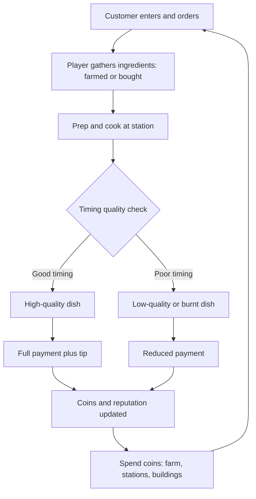

# Slice & Sprout — 3D Browser Restaurant, Farm & Tycoon Game
### Product Requirements Document — written for handoff to an AI coding agent

**Prepared:** September 2026 &nbsp;|&nbsp; **Status:** Ready for Phase 0 &nbsp;|&nbsp; **Version:** 1.0

---

## 0. How to Use This Document

This PRD is written to be **implementation-agent-agnostic** — any coding agent that can read markdown and write to a repo (Claude Code, Cursor, or similar) can execute it directly, with no human translation step needed in between.

Ground rules for whoever builds from this:

1. **Build in phase order** (Section 9). Don't start Phase 2 systems before Phase 1's Definition of Done (Section 13) passes. Attempting everything at once is the single biggest risk on a project this size (Section 12).
2. **Every feature has explicit, testable acceptance criteria.** If a checkbox can't be verified by playing the game or inspecting a save file, it isn't done.
3. **Everything is data-driven.** New recipes, crops, and buildings should mean adding a JSON entry, not writing new code. This is how a genuinely large, ever-growing feature set (Section 10) stays achievable instead of becoming hundreds of one-off systems.
4. The working title **"Slice & Sprout"** and every name in this doc are placeholders — rename freely.

---

## 1. Vision & Concept

**Elevator pitch:** a cozy, colorful 3D browser game where the player runs a pizza restaurant, grows their own ingredients on an attached farm, and reinvests profits into expanding both — in the spirit of casual restaurant/tycoon management games, rendered in real 3D instead of flat sprites.

- **Genre:** cozy management/tycoon sim, single continuous 3D world, third-person camera.
- **Tone:** warm and low-stakes. No fail state that erases progress — the worst outcome is one unhappy customer or one wilted crop, never a "game over."
- **Platforms:** desktop and mobile web browsers, played at a URL, no install.
- **Why 3D:** depth is what makes the day/night cycle, weather, and a walkable farm-to-kitchen loop actually matter spatially — you *see* the sun set over your fields and *walk* the harvest to the kitchen, rather than reading numbers on a 2D board.
- **Original IP only:** no real restaurant brands, logos, or copyrighted characters anywhere in scope.

---

## 2. Assumptions & Scope Decisions

Stated explicitly because the brief didn't pin these down — flag any that should change before Phase 0 starts.

| Area | Assumption |
|---|---|
| Players | Single-player at launch. Multiplayer is a Phase 5+ stretch (5.16), not required for a complete game. |
| Monetization | None specified — out of scope. Every system assumes a free, complete game. |
| Backend | **Not required for the core game.** Money, farm state, and buildings all save locally in the browser. A backend is optional and only added later for cross-device saves or leaderboards (3.4). |
| Branding | Fully original — "Slice & Sprout" is a placeholder name, not a real brand. |
| Art assets | Stylized low-poly (Section 8) — buildable from free CC0 asset packs or simple procedural geometry, since no dedicated 3D artist is assumed. |
| Input | Desktop keyboard+mouse *and* mobile touch are both MVP requirements, not a later add-on. |

---

## 3. Technical Stack

### 3.1 Rendering engine — comparison

| Engine | Type | Strengths | Trade-offs | Verdict |
|---|---|---|---|---|
| **Three.js** | Code-first JS/TS library | Enormous ecosystem; everything is plain code, ideal for an agent with no GUI; `WebGPURenderer` is now a near one-line swap from `WebGLRenderer` with automatic WebGL2 fallback | You assemble physics/UI/audio from separate libraries yourself | **Recommended** |
| **Babylon.js** | JS/TS engine | WebGPU-first since v5; batteries-included (physics, GUI, audio); ships its own desktop Editor and Inspector | Heavier API surface; the visual Editor adds little for a code-only agent | Strong alternative |
| **PlayCanvas** | JS engine, code-first with optional cloud editor | Excellent performance, open-source core, fully self-hostable without the cloud editor | Best workflows lean on the hosted editor | Alternative if you want a visual editor available |
| **Godot (Web export)** | Full engine, GDScript (Python-like syntax) | Physics, navigation, tilemaps, and particles all built in | Official web export is still WebGL-only — WebGPU-for-web is an experimental third-party project as of 2026; `.tscn` scene files are far less common in AI agents' training data than plain JS/TS repos | Only if you plan to drive the Godot editor yourself |

**Recommendation: Three.js + TypeScript.** For "hand this to any AI agent," the deciding factor is that scene, UI, and logic all live in readable, diffable code files with zero GUI dependency — and its WebGPU path (mature since the r171 renderer swap, ~95% of browsers WebGPU-capable, automatic fallback for the rest) is safe to build on today.

### 3.2 Supporting libraries

- **Physics:** `@dimforge/rapier3d` — WASM, fast, deterministic (good for consistent crop/building collision)
- **UI overlay:** React, rendered as a DOM layer over the canvas (HUD, menus, build panel) — keeps UI code fully separate from render code
- **State management:** one central store (Zustand — small and agent-friendly) as the single source of truth; saving just serializes this store
- **Build tooling:** Vite
- **Asset format:** glTF 2.0 with Draco compression

### 3.3 Hosting (MVP)

Fully static — the whole MVP is HTML/JS/CSS/assets, **no server required.** Deploy to any self-hosted static host (nginx/Caddy on your own box) or a PaaS you already use. Game state persists via **IndexedDB** (chosen over `localStorage` for the larger quota, needed once saves include full farm/building layouts).

### 3.4 Optional backend (Phase 5+, *not* MVP)

Only needed for cross-device saves or leaderboards. If added later: **Node.js + MongoDB Atlas**, matching your existing stack from other recent builds rather than introducing a new backend paradigm just for this project.

---

## 4. Core Gameplay Loop



The day/night cycle and weather system (5.5, 5.6) modulate the pacing of this loop throughout a session without changing its shape.

---

## 5. Feature Systems

Each system below lists its mechanics, then explicit acceptance criteria. Systems 5.1–5.4 and 5.9–5.11, 5.13, 5.15 are MVP (Phase 1). 5.2, 5.3 are Phase 2. 5.5–5.7 are Phase 3. 5.10, 5.12, 5.14 are Phase 4. 5.16 is Phase 5+.

### 5.1 Restaurant Operations
**Mechanics**
- Customers spawn on a variable interval (starts ~20–40s, tightens as reputation rises, floor ~8s) and join a queue or take an open table.
- Each order draws one recipe from the player's *unlocked* pool, weighted by a `popularity` field, plus 0–2 modifiers ("extra cheese," "no onion") that adjust price and prep.
- Stations: **Prep** (assemble base + toppings), **Oven** (a timing bar — pulling the dish in the "golden" window gives full quality; early or late gives a quality penalty or a burnt result), **Counter** (serve to the correct customer).
- Each customer has a visible **patience meter** that depletes faster while unattended and slower once the order is placed; reaching zero means the customer leaves unhappy (reputation penalty, no payment) — never a hard fail for the player.
- **Reputation**: a 1–5 star rolling average of recent outcomes, gating spawn rate and which recipes/customers appear.

**Acceptance criteria**
- [ ] A customer can enter, order, be served the correct dish, and pay — entirely through the UI, no debug intervention.
- [ ] Serving the wrong recipe is rejected with clear feedback, not a silent failure.
- [ ] Patience visibly decreases, and a customer leaving updates reputation within one frame of the event.
- [ ] At least 3 distinct recipes are completable at MVP.

### 5.2 Farming System
**Mechanics**
- Grid of farm plots, each in state `empty → tilled → planted → growing (stage 1..N) → ready → harvested`.
- Each crop defines `baseGrowthSeconds`, a yield range, and a `weatherModifiers` map (Section 6) — e.g. tomatoes grow faster in `clear`, mushrooms faster in `rain`.
- Manual watering speeds growth by a fixed percentage; an unlockable sprinkler building automates it for nearby plots.
- Crops feed directly into recipes — a farmed tomato should be visibly cheaper than a bought one (Section 11), so the farm has a real economic reason to exist, not just flavor.

**Acceptance criteria**
- [ ] A plot can be tilled, planted, watered, and harvested with visible stage changes in the 3D world, not just a UI number.
- [ ] A harvested crop is consumable by at least one recipe's prep step.
- [ ] Growth timers persist correctly across save/reload — a crop planted, then the tab closed and reopened later, has grown by the correct elapsed time, capped at "ready" (no negative-time exploits).

### 5.3 Building & Construction
**Mechanics**
- Grid-snapped placement with a ghost preview (green = valid, red = collision/out of bounds).
- Categories: **Restaurant** (tables, stations, expansions), **Farm** (storage, sprinklers, a greenhouse that removes weather dependency), **Decoration** (raises an "ambiance" score that boosts tips), **Infrastructure** (paths that speed NPC pathing).
- Costs coins and is gated by player level (5.10).

**Acceptance criteria**
- [ ] Placement fails cleanly (no crash, clear message) on collision or insufficient funds.
- [ ] A placed building persists through save/reload at the correct grid position and rotation.
- [ ] At least one building from each category exists by the Phase 2 exit.

### 5.4 Economy & Money System
**Mechanics**
- Single soft currency ("Coins"). Income: order payments, tips, crop sales. Expenses: staff wages (charged once per in-game day), building costs, optional ingredient restocking.
- HUD shows an animated running total (ticks, doesn't snap) plus a short transaction log.
- Starting balance ratios: Section 11.

**Acceptance criteria**
- [ ] Every coin change is traceable to a logged transaction.
- [ ] Balance persists exactly across save/reload — no drift.

### 5.5 Day/Night Cycle
**Mechanics**
- Configurable day length (default 12 real minutes = 1 in-game day, adjustable in Settings).
- Directional light angle and color temperature shift continuously — warm low-angle light at dawn/dusk, neutral at midday, cool blue at night with building/street lights switching on below a brightness threshold.
- Certain customer types are time-gated (a breakfast rush, a dinner rush, sparse late-night stragglers) to give the day rhythm.

**Acceptance criteria**
- [ ] A full cycle completes and loops with no visible seam or lighting pop.
- [ ] At least one customer type or crop behavior measurably differs between day and night.

### 5.6 Weather System
**Mechanics**
- States: `clear`, `cloudy`, `rain`, `storm` (snow reserved for a Phase 5+ seasonal pass). Transitions are weighted-random, rolled once per in-game morning, and always step through `cloudy` rather than jumping straight from `clear` to `storm`.
- Visuals: particle rain, dynamic cloud density, a simple wet-ground effect (darken + raise specular — full puddle simulation is out of scope for MVP).
- Gameplay: rain boosts certain crops and measurably reduces outdoor foot traffic (indoor seating unaffected); storms can send customers home early.

**Acceptance criteria**
- [ ] Weather visibly cycles between at least clear and rain without a page reload.
- [ ] At least one crop and one customer-traffic behavior are measurably affected by weather state.

### 5.7 Minimap & Navigation
**Mechanics**
- A secondary top-down orthographic camera renders to a texture, shown as a HUD element (default top-right) with the player's position/facing and key points of interest (farm, kitchen, market, delivery point).
- Tap/click expands it to a full-screen map with pan/zoom.

**Acceptance criteria**
- [ ] The minimap updates in real time as the player moves.
- [ ] At least 2 points of interest are marked by the Phase 3 exit.

### 5.8 NPCs — Customers & Staff
**Mechanics**
- Customer state machine: `enter → path to queue/table → order → wait (patience) → eat/receive → leave (happy/neutral/annoyed, weighted by wait time and quality) → despawn`. A waypoint graph is sufficient for MVP; upgrade to a navmesh library only if pathing quality demands it.
- Staff: hireable NPCs, one per station, running a simplified version of the same loop automatically for a daily wage; `skillLevel` affects their speed and quality.

**Acceptance criteria**
- [ ] A customer's path from entrance to table/counter never clips through furniture in the default layout.
- [ ] A hired staff member visibly performs their station's task with no player input.

### 5.9 Player Controller & Camera
**Mechanics**
- Third-person, semi-fixed orbit camera (mouse-drag to orbit, scroll to zoom); WASD/arrow movement on desktop.
- Mobile: virtual joystick + tap-to-move, same camera behavior.
- Optional click-to-move on desktop for tycoon-style ease of use.

**Acceptance criteria**
- [ ] Movement and camera work identically in behavior on mouse+keyboard and on touch.
- [ ] Camera never clips through terrain or buildings in the default map.

### 5.10 Progression, Leveling & Achievements
**Mechanics**
- XP from serving orders and harvesting; levels gate new recipes, plots, buildings, and decorations.
- Achievements ("Serve 100 dishes," "Reach 5 stars") are a simple rule list checked against game state, surfaced as a toast — no separate engine needed.

**Acceptance criteria**
- [ ] Leveling up immediately unlocks the tied content in the relevant menu, not just a hidden flag.
- [ ] At least 5 achievements exist and are checkable against the SaveGame schema (Section 6).

### 5.11 Save/Load & Persistence
**Mechanics**
- Autosave on a timer (default every 2 minutes) and on major actions (purchase, day rollover). Up to 3 manual slots. Stored in IndexedDB as JSON matching the SaveGame schema (Section 6), versioned for future migrations.

**Acceptance criteria**
- [ ] Closing and reopening the tab restores the exact state (coins, farm, buildings, day/time) from the last autosave.
- [ ] A corrupted save fails gracefully with an option to start fresh — never a silent crash.

### 5.12 Audio
**Mechanics**
- Layered ambience (daytime chatter/birds, night crickets, a rain loop), station SFX (sizzling, chopping), a cash-register cue on payment, and a looping, mutable music bed.

**Acceptance criteria**
- [ ] Every audio layer has an independent volume slider and a master mute, and starts only after a user gesture (browser autoplay compliance).

### 5.13 Settings & Accessibility
**Mechanics**
- Graphics presets (Low/Medium/High — shadow quality, particle density, draw distance), essential for mobile performance.
- Colorblind-safe UI: patience meters and quality indicators use shape/icon redundancy, not color alone.
- Remappable controls (desktop), adjustable UI scale (mobile).

**Acceptance criteria**
- [ ] Switching to Low measurably improves frame rate on a mid-range mobile device.
- [ ] Every color-coded status also has a non-color indicator.

### 5.14 Tutorial / Onboarding
**Mechanics**
- A skippable guided first day: tooltips walk through the first order, first cook, first plant, first building placement.

**Acceptance criteria**
- [ ] A new save triggers the tutorial; a save with `tutorialComplete: true` never shows it again.

### 5.15 UI / HUD
**Mechanics**
- Persistent HUD: coin counter, day/time indicator, weather icon, minimap, notification toasts.
- Menus: pause, settings, inventory, build menu, recipe book, shop.

**Acceptance criteria**
- [ ] Every HUD element updates within one frame of its underlying state changing.
- [ ] All menus are reachable and closeable via both mouse and touch.

### 5.16 Multiplayer & Social (stretch — Phase 5+)
**Mechanics**
- Visit a friend's restaurant/farm (read-only, or light interactions like leaving a tip or helping harvest), plus simple leaderboards. Requires the optional backend (3.4).

**Acceptance criteria:** defined when this phase is actually scheduled — not required for a complete, shippable game.

---

## 6. Data Schemas

Illustrative JSON — the actual TypeScript types should mirror these shapes.

**Recipe**
```json
{
  "id": "margherita_pizza",
  "name": "Margherita Pizza",
  "basePrice": 8.50,
  "popularity": 0.7,
  "prepTimeSeconds": 25,
  "ingredients": [
    { "itemId": "dough", "qty": 1 },
    { "itemId": "tomato_sauce", "qty": 1 },
    { "itemId": "mozzarella", "qty": 2 },
    { "itemId": "basil", "qty": 1 }
  ],
  "cookStation": "oven",
  "idealBakeSeconds": 12,
  "unlockLevel": 1
}
```

**Crop**
```json
{
  "id": "tomato",
  "name": "Tomato",
  "baseGrowthSeconds": 600,
  "yieldMin": 2,
  "yieldMax": 4,
  "weatherModifiers": { "clear": 1.0, "cloudy": 1.0, "rain": 1.15, "storm": 0.9 },
  "sellValue": 1.2,
  "usedInRecipes": ["margherita_pizza", "veggie_pizza"]
}
```

**Order**
```json
{
  "orderId": "uuid",
  "customerId": "uuid",
  "recipeId": "margherita_pizza",
  "modifiers": ["extra_cheese"],
  "patienceSeconds": 90,
  "createdAt": 1234567890,
  "status": "waiting"
}
```

**Building**
```json
{
  "typeId": "sprinkler_basic",
  "category": "farm",
  "cost": 150,
  "unlockLevel": 3,
  "footprint": { "width": 1, "depth": 1 },
  "effect": { "type": "auto_water", "radiusTiles": 2 }
}
```

**SaveGame** (top level)
```json
{
  "version": 1,
  "coins": 0,
  "level": 1,
  "xp": 0,
  "day": 1,
  "timeOfDaySeconds": 0,
  "weather": "clear",
  "reputationStars": 3,
  "tutorialComplete": false,
  "unlockedRecipes": ["margherita_pizza"],
  "farmPlots": [ { "plotId": 0, "state": "empty", "cropId": null, "plantedAt": null } ],
  "buildings": [ { "buildingId": "uuid", "typeId": "table_basic", "x": 3, "z": 5, "rotation": 0 } ],
  "inventory": { "tomato": 5, "dough": 10 },
  "staff": [],
  "achievements": []
}
```

---

## 7. Performance & Non-Functional Requirements

- **Frame rate:** 60 FPS on a mid-range 2023+ desktop/laptop GPU; 30+ FPS on a mid-range 2022+ mobile phone.
- **Load time:** core bundle under ~5MB gzipped; additional assets lazy-loaded per zone.
- **Browser support:** latest two versions of Chrome, Edge, Firefox, and Safari (desktop and iOS).
- **Required techniques** (not optional, given the object counts a farm+restaurant scene implies):
  - `InstancedMesh` for repeated objects (crops, identical furniture/decor)
  - Frustum culling via sensibly-chunked geometry — never one giant world mesh
  - Texture atlasing and glTF+Draco compression for asset size
  - A fixed-timestep simulation clock decoupled from render framerate, with a clamped max delta to avoid a "spiral of death" when a backgrounded tab resumes

---

## 8. Art & Audio Direction

**Named direction: "sun-baked terracotta & vine."** Warm terracotta rooftops, sun-bleached wood counters, vine-green farm plots, amber string lights that switch on at dusk.

- Low-poly, flat-shaded or simple-gradient materials — no complex PBR pipeline needed.
- Start from free CC0 low-poly asset packs (Kenney.nl-style) rather than commissioning custom art, consistent with the "no dedicated 3D artist" assumption (Section 2).
- Silhouette-readable design throughout — the genre lives or dies on instantly reading "is this plot ready to harvest" and "is this customer about to leave," at a glance, from across the room.

---

## 9. Phased Roadmap


| Phase | Contents | Exit criteria |
|---|---|---|
| **0 — Prototype** | One continuous 3D scene, third-person controller, one station, one recipe, a coin counter that updates on serve | A single order can be completed start to finish |
| **1 — MVP** | Full order/queue/patience loop, 3+ recipes, Prep/Oven/Counter stations, reputation, save/load | Section 13's Definition of Done passes in full |
| **2 — Farming & Building** | Farm plots, 3+ crops tied to recipes, grid building placement, first building categories | A grown crop completes an order; a building persists through reload |
| **3 — World Systems** | Day/night, weather, minimap, time-gated customers | Sections 5.5–5.7 acceptance criteria all pass |
| **4 — Progression & Polish** | XP/leveling, achievements, audio pass, settings/accessibility, tutorial | A first-time player reaches level 3 unassisted |
| **5 — Stretch** | Optional backend, multiplayer/social, seasonal events, additional restaurant types, cosmetics | Scoped and scheduled separately when reached |

---

## 10. Extensive Feature Backlog

Because every system above is data-driven, most of these mean adding one JSON entry, not new code — this is how the feature set grows large without becoming unmaintainable. **None of this is required for MVP;** it's the well the game draws from after Phase 4.

**Restaurant content:** calzones, stuffed crust, dessert pizza, salads, a soda fountain, seasonal limited-time recipes, combo meals, a loyalty punch-card, catering orders (bigger batch, bigger payout, longer deadline), a delivery-bike mode, a food-truck satellite location, a customer review board, a rotating "chef's special," spice-level modifiers, dietary tags (vegetarian, gluten-free) some customers request, plating/presentation bonuses.

**Farming content:** basil, mushrooms, peppers, onions, wheat, olives, fruit trees with longer cycles, a chicken coop, a small dairy operation, crop cross-breeding, a light pest mini-game (framed positively, never punishing), fertilizer trade-offs, seasonal crop rotation, a functional scarecrow decoration, rare "golden" crop variants.

**Building & decor:** weather-exposed outdoor seating, a rooftop garden, a fountain/pond, string lights and lanterns, seasonal decor sets, a customizable sign/marquee, a parking area, a delivery dock, tiered storage silos, a basic/glass/heated greenhouse ladder.

**Economy & meta:** daily/weekly challenges with bonus payouts, a small loan system for early expansion, permanent purchasable upgrades ("faster oven"), a prestige/rebirth system for long-term replay, cosmetic sign/avatar skins, an end-of-day business-report summary.

**World & atmosphere:** four seasons affecting available crops/decor, festivals and holiday events with limited-time recipes, ambient wildlife (birds, butterflies), a day-length slider, a photo-mode camera.

**Social (Phase 5+):** visiting friends' restaurants, a leaderboard, gifting ingredients, a shared community market, two-player co-op on one restaurant.

**Quality of life:** a fast-forward button for slow stretches, a favorites/quick-order recipe book, an in-game "what's new" panel, controller support.

---

## 11. Economy Balancing Guidelines

Starting heuristics to implement, then tune through actual playtesting — treat as a first draft, not gospel:

- **Bought ingredient cost** ≈ 30–40% of a recipe's base sell price, leaving roughly 60–70% gross margin before wages/building costs.
- **Farmed ingredients** should cost roughly 40–60% less (in time + plot-space opportunity cost) than bought ones, so farming is a genuine economic choice, not just flavor.
- **Staff wages:** a hired staff member's output should exceed their daily wage by roughly 2x, or players won't bother hiring — automation needs to feel net-positive quickly.
- **Building cost curve:** each tier should take noticeably longer to afford than the last (a soft prestige curve), but never more than a few real-world play sessions at MVP's default pacing.

---

## 12. Risks & Mitigations

| Risk | Mitigation |
|---|---|
| Scope creep — attempting the full backlog at once ships nothing | Strict phase gating (Section 9); Section 10 is explicitly post-MVP |
| Performance collapse from object count (crops, customers, decor) | Instancing, culling, LOD are mandated in Section 7, not optional |
| Asset-creation bottleneck — no dedicated 3D artist | Free CC0 low-poly packs + simple procedural geometry (Section 8) |
| Save corruption / data loss | Versioned schema (Section 6), autosave + manual slots, graceful fallback |
| Mobile performance/input gap | Touch controls and a Low graphics preset are MVP requirements, not later add-ons |

---

## 13. MVP Definition of Done

- [ ] Player can walk a single continuous 3D world with a working camera on both desktop and touch input.
- [ ] At least 3 recipes are completable end-to-end (order → prep → cook → serve → payment).
- [ ] Reputation and patience systems are functional and visible in the HUD.
- [ ] The money counter is accurate and persists via save/load across a page reload.
- [ ] Runs at the Section 7 performance targets with MVP-scale content loaded.
- [ ] A first-time player can complete the tutorial unassisted.

---

## 14. Glossary

- **Plot** — a single farmable tile.
- **Station** — a restaurant workstation (Prep, Oven, Counter).
- **Patience** — a customer's countdown to leaving unhappy.
- **Reputation** — 1–5 star rolling average driving spawn rate and unlocks.
- **Ambiance** — a decoration-driven score that boosts tips.
- **Backlog** — Section 10's post-MVP content list; never a Phase 0–4 requirement.
